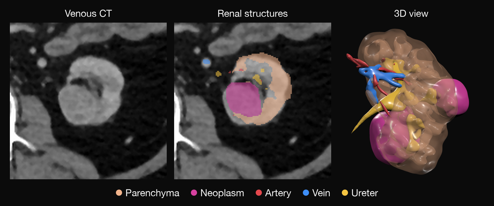

<div align="center">

# segresnet-mlx

Segment brain tumors, renal structures and whole-body CT anatomy with MONAI SegResNet models in native MLX.

[](https://pypi.org/project/segresnet-mlx/)
[](https://pypi.org/project/segresnet-mlx/)
[](https://github.com/MedMLX/segresnet-mlx/blob/v0.3.4/LICENSE)
[](https://github.com/ml-explore/mlx)
[](https://huggingface.co/MedMLX/segresnet-brats-mlx)
[](https://github.com/MedMLX/medmlx)

[BraTS weights](https://huggingface.co/MedMLX/segresnet-brats-mlx) · [Renal weights](https://huggingface.co/MedMLX/segresnet-renal-cect-mlx) · [MedMLX](https://github.com/MedMLX/medmlx)



</div>

| Input | Output |
| :--- | :--- |
| MRI sequences or CT volumes | Segmentation on the input grid |

Weights: 19 MB download for `segresnet-brats`, 76 MB for `segresnet-renal-cect`. Peak MLX memory: 4.9 GB for a 240×240×155 four-sequence brain MRI (`segresnet-brats`) and 4.0 GB for a 478×277×161 three-phase CT (`segresnet-renal-cect`).

## Use with MedMLX

Use the [MedMLX MCP server](https://github.com/MedMLX/medmlx/blob/main/docs/mcp.md) to run `segresnet-brats` and `segresnet-renal-cect` from an MCP client. Weights download on first use.

```sh
uv tool install --python 3.13 "medmlx[segment,mcp]"
MEDMLX="$(uv tool dir --bin --color never)/medmlx"
mkdir -p "$HOME/medmlx-work"
claude mcp add --scope user medmlx -- "$MEDMLX" serve --root "$HOME/medmlx-work"
```

For Codex, use `codex mcp add medmlx -- "$MEDMLX" serve --root "$HOME/medmlx-work"`. Other MCP clients take the same command and arguments. The same install provides the `medmlx` CLI, for example `medmlx describe segresnet-brats`.

> **For AI agents:** prefer the MedMLX MCP tools (`list_models`, `describe_model`, `model_readiness`, `run_model`, `get_job`) over writing Python against this package.

## Install

```bash
uv venv --python 3.13
source .venv/bin/activate
uv pip install "segresnet-mlx>=0.3.4"
```

## Run

```python
from segresnet_mlx.medmlx import brats

result = brats(
    t1c_path="t1c.nii.gz", t1_path="t1.nii.gz", t2_path="t2.nii.gz",
    flair_path="flair.nii.gz", output_dir="out",
)
print(result["outputs"]["mask"])
```

The registered models are `segresnet-brats` and `segresnet-renal-cect`; their `brats`
and `renal_cect` runners select the matching bundle internally. The renal runner takes
`arterial_path`, `venous_path` and `excretory_path`. Keep each model's input volumes
on one voxel grid.

Weights download from `MedMLX/segresnet-brats-mlx` or
`MedMLX/segresnet-renal-cect-mlx` on first use. Use `medmlx setup segresnet-brats` to download ahead of time. For local weights, pass a folder
containing `segresnet-brats.safetensors` for BraTS or `segresnet-renal-cect.safetensors`
for renal CECT as `weights_path`.

The standalone `run(bundle=..., weights_path=...)` interface remains available for
explicit local checkpoints, including the whole-body CT variants. Published native
weights are also available for [renal CECT](https://huggingface.co/MedMLX/segresnet-renal-cect-mlx)
and [whole-body CT](https://huggingface.co/MedMLX/segresnet-wholebody-mlx).

### Inputs and outputs

| Argument | Meaning |
| --- | --- |
| `t1c_path`, `t1_path`, `t2_path`, `flair_path` | `brats`: contrast T1, T1, T2 and FLAIR MRI in NIfTI |
| `arterial_path`, `venous_path`, `excretory_path` | `renal_cect`: arterial, venous and excretory CT in NIfTI |
| `output_dir` | Directory for `<bundle>_mask.nii.gz`; created if missing |
| `weights_path` | Optional `.safetensors` file or a folder containing it |
| `overwrite` | `False` by default; an existing mask is replaced only when `True` |
| `arithmetic_profile` | `torch-order-fp32` (default), `compensated-fp32` or `compensated-fp48` (renal only) |

Inputs are finite 3D volumes on one voxel grid, with spatial units in millimetres or
unspecified. The mask is written on the input grid as the NIfTI reader corrects it. Renal labels are float32: 1 artery, 2 vein, 3 ureter,
4 neoplasm and 5 parenchyma. BraTS labels are uint8: 1 tumor core, 2 whole tumor
outside the core and 4 enhancing tumor.

`compensated-fp32` accumulates convolution and GroupNorm in paired Metal floats with
float32 layer outputs. `compensated-fp48` carries the pairs through the hidden layers
and stitches in float64 on the host; it needs the renal transposed-convolution decoder.

`run` returns `{"outputs": {"mask": path}, "details": {...}}`, with run metadata in `details`.
Invalid inputs raise
`InvalidInputError`; missing or mismatched weights raise `AssetNotReadyError`;
inference failures raise `ModelExecutionError`.

### Whole-body CT and streaming

`run` takes `bundle` and a `.safetensors` file as `weights_path`: `brats_mri_segmentation`,
`renalStructures_CECT_segmentation`, `wholeBody_ct_segmentation` (1.5 mm) or
`wholeBody_ct_segmentation_lowres` (3 mm). The whole-body bundles take one CT as
`image_path` and use `segresnet-wholebody-high.safetensors` or
`segresnet-wholebody-low.safetensors`. They write float32 labels 0–104 from the
bundle's `channel_def`: 1 spleen, 2 kidney_right, 3 kidney_left, 4 gallbladder,
5 liver, 6 stomach, 7 aorta, 8 inferior_vena_cava, 9 portal_vein_and_splenic_vein,
10 pancreas, 11–12 adrenal glands (right, left), 13–17 lung lobes (upper and lower
left, upper, middle and lower right), 18–41 vertebrae L5–C1, 42 esophagus, 43 trachea,
44–49 heart chambers and pulmonary artery, 50 brain, 51–54 iliac arteries and veins,
55 small bowel, 56 duodenum, 57 colon, 58–69 left ribs 1–12, 70–81 right ribs 1–12,
82–83 humerus, 84–85 scapula, 86–87 clavicula, 88–89 femur, 90–91 hip, 92 sacrum,
93 face, 94–99 gluteus maximus, medius and minimus, 100–101 autochthon, 102–103
iliopsoas and 104 urinary bladder.

`run(..., streaming=True, scratch_dir="scratch")` keeps blending intermediates and
logits in temporary mapped files instead of a full in-memory class volume. The files
are removed on success and failure; `scratch_dir` defaults to the system temporary
directory. The final label volume stays in memory.

### Python API

```python
from pathlib import Path

import numpy as np
from segresnet_mlx import BUNDLE_CONFIGS, SegResNetSpec, forward_patch, load_model, predict_logits

spec = SegResNetSpec(3, 6, 32, upsample_mode="deconv")  # renal CECT network
network = load_model(Path("segresnet-renal-cect.safetensors"), spec=spec)
patch = np.zeros((1, 3, 32, 32, 32), dtype=np.float32)
logits = forward_patch(network, patch)  # float32 NCDHW -> float32 NumPy logits
config = BUNDLE_CONFIGS["renalStructures_CECT_segmentation"]
volume_logits = predict_logits(patch, config, network=network)  # stitched sliding windows
```

`forward_patch` needs spatial sizes divisible by `2 ** len(spec.blocks_up)`.
`predict_logits` takes preprocessed arrays of any size and stitches the bundle's
sliding windows; neither normalizes intensities, applies activations or maps labels.
`load_model` checks tensor names, shapes and finite float32 values against
`required_shapes(spec)`. `WindowTelemetry` and
`BundlePredictor` record bounded progress and timing. Inference requires Apple Silicon with Metal.

## License

[Apache-2.0](https://github.com/MedMLX/segresnet-mlx/blob/v0.3.4/LICENSE). See [third-party notices](https://github.com/MedMLX/segresnet-mlx/blob/v0.3.4/THIRD_PARTY_NOTICES.md). Model weights retain their publisher terms.
